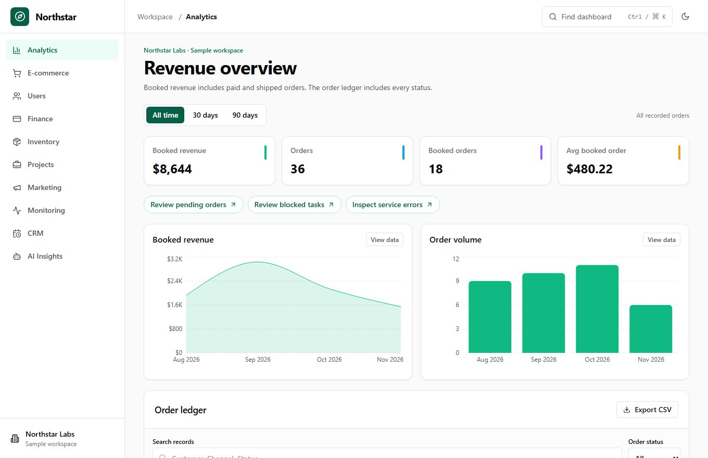

# Multi Dashboard SaaS Kit

Northstar is a multi-tenant reporting workspace with ten dashboards, a React frontend, and an Express and PostgreSQL API.

[Open the interactive demo](https://deba-maity.github.io/multi-dashboard-saas-kit/)



**Try a two-minute walkthrough**

1. In Analytics, select **30 days**. Compare booked revenue with the previous 30 complete UTC days, then use **View data** to see the numbers behind the chart.
2. Open **Review blocked tasks**, choose a task, change its status to **In progress**, and save. The task leaves the blocked queue and the status totals update. **Reset sample tasks** restores the starting board.
3. In Inventory, choose **Low** under the reorder chart. Save the view, copy the filtered link, or export the matching SKUs to CSV.

In **Finance**, select **Past-due invoices** to see the balances behind the count. In **AI Insights**, move **Change from booked revenue** to compare each month with your assumption. **Ctrl+K** (or **⌘K**) opens report search.

GitHub Pages serves fictional snapshots and keeps task changes and saved views in the current browser. The full-stack app authenticates users and persists task status in PostgreSQL. Shared links preserve the report settings. They do not transfer browser-local task edits.

## Stack

- Frontend: React, Vite, Tailwind CSS, React Query, Recharts
- Backend: Node.js, Express, Prisma, PostgreSQL
- Security: JWT access tokens, refresh tokens, bcrypt password hashing, RBAC middleware, rate limiting, Helmet
- Architecture: npm workspaces monorepo with shared TypeScript dashboard types

## Dashboards

- Analytics: KPIs, revenue trend, order volume, period comparisons
- E-commerce: orders, products, fulfillment status, channel revenue
- User Management: members, roles, statuses, protected CRUD invitation flow
- Finance / Billing: transaction and invoice ledgers, receivable balances by days past due, and filtered CSV exports
- Inventory: stock levels, warehouses, reorder alerts
- Project Management: task board, priority mix, assignments
- Marketing: campaign ROI, clicks, conversions, channel comparison
- System Monitoring: service-level events and error rates, average and P95 latency, and drill-downs to individual logs
- CRM: leads, contacts, deal pipeline, forecast widgets
- AI / Insights: recommendation scores and an adjustable monthly booked-revenue scenario with CSV export

## Quick Start

1. Install dependencies:

   ```bash
   npm ci
   ```

2. Copy environment variables:

   ```bash
   cp .env.example apps/backend/.env
   cp .env.example apps/frontend/.env
   ```

3. Start PostgreSQL and create a database named `multi_dashboard_saas`.

4. Run the migration and seed a dedicated demo database. The seed replaces its existing application data.

   ```bash
   npm run db:migrate
   npm run db:seed
   ```

5. Start the backend and frontend in separate terminals:

   ```bash
   npm run dev:backend
   npm run dev:frontend
   ```

6. Open `http://localhost:5173` and sign in with:

   ```text
   avery@northstar.test
   Password123!
   ```

## API Modules

- `POST /api/auth/login`
- `POST /api/auth/register`
- `POST /api/auth/refresh`
- `POST /api/auth/logout`
- `PATCH /api/tasks/:id/status`
- `GET /api/users`
- `POST /api/users`
- `PATCH /api/users/:id`
- `DELETE /api/users/:id`
- `GET /api/organizations/current`
- `GET /api/dashboard-data/:dashboard`
- `GET /api/dashboard-data/:dashboard/records` for Finance, Inventory, and Monitoring ledger pages
- `GET /api/logs`
- `GET /api/transactions`

Every business endpoint is scoped to the authenticated user's organization. Admin-only mutations use the RBAC middleware.

## Build and verify

- `npm run build` generates the Prisma client and builds the API and frontend.
- `npm test` checks reporting windows, totals, summaries, and pagination.
- `npm run test:api` uses `TEST_DATABASE_URL` for a migrated PostgreSQL test database. It creates two temporary organizations and removes its fixtures afterward.
- `npx playwright install chromium` installs the browser. `npm run test:demo` builds and previews the Pages site and exercises its main workflows.
- `npm run build:demo` produces `apps/frontend/dist` using the checked-in sample snapshots. To regenerate them, point `DATABASE_URL` at the dedicated fictional seed database, set `PAGES_DEMO_SEED_DATABASE=1`, and run `npm run demo:export --workspace @saas-kit/backend`.

## Folder Structure

```text
apps/
  backend/
    prisma/
      schema.prisma
      seed.ts
    src/
      middleware/
      routes/
      services/
      utils/
  frontend/
    src/
      components/
      lib/
      pages/
      providers/
packages/
  shared/
    src/index.ts
```

## Notes For Production

- Replace JWT secrets with long random values.
- Put refresh tokens in secure, httpOnly cookies if your deployment allows same-site cookie auth.
- Add audit logs around admin mutations.
- Wire the AI insights service to your ML or analytics backend when replacing the seeded mock scoring.
- Add CI for `npm run build`, migrations, and API integration tests.
